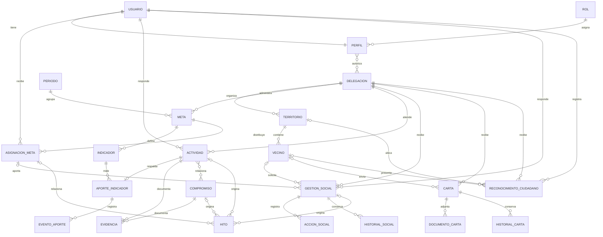

# Documentación para la evaluación del SGR

## Alcance

Este documento describe la aplicación local y sus flujos funcionales para la evaluación. Los datos usados en la demostración deben ser ficticios. No se incluyen capturas simuladas: se deben agregar imágenes tomadas de la interfaz real cuando se ejecute la demostración.

## Diseño técnico

La aplicación está desarrollada con Python y Django. Las vistas web usan Django Templates y Bootstrap; Django ORM y sus migraciones administran la persistencia relacional. La lógica de negocio se distribuye por dominio:

| Dominio | Responsabilidad |
|---|---|
| `usuarios` | Cuentas, perfiles, roles, delegaciones, territorios y vecinos. |
| `atenciones` | Actividades, historial de estados y reclamos/felicitaciones. |
| `evidencias` | Carga y validación de archivos vinculados a actividades o compromisos. |
| `sgr` | Períodos, metas, indicadores, asignaciones, aportes y cálculos del dashboard. |
| `agenda` | Compromisos, plazos y vista del Tubo. |
| `gestion_social` | Casos sociales, acciones y seguimiento de hitos de atención. |
| `cartas` | Cartas, documentos y seguimiento. |
| `hitos` | Hitos asociados a una actividad, gestión social o compromiso. |

Las reglas de acceso se aplican en servidor. Las vistas filtran los registros por las delegaciones autorizadas; administradores pueden operar en contexto global. Los cambios de estado y acciones relevantes quedan en historial o auditoría. El panel administrativo no permite el borrado físico de actividades, evidencias, compromisos, cartas, gestiones sociales, hitos ni reclamos/felicitaciones.

## Modelo de datos resumido

El diagrama es una vista lógica de las relaciones principales; no reemplaza el esquema completo de migraciones.

## Roles y alcance

| Rol | Acceso funcional resumido |
|---|---|
| Administrador | Gestión global, cuentas y configuración. El acceso global no habilita el borrado físico desde el panel administrativo. |
| Delegado | Gestión de las delegaciones autorizadas; puede programar hitos. |
| Coordinador | Supervisión, catálogos y funciones de gestión habilitadas dentro de su alcance territorial. |
| Verificador | Revisión de evidencias y acceso acotado a registros asignados o autorizados. |
| Funcionario | Registro y seguimiento de información propia o asignada, incluida la carga de evidencias. |

El sistema comprueba el rol activo y la delegación autorizada en cada operación; la interfaz no es la única barrera de acceso. Los cargos laborales de la guía no sustituyen estos roles de autorización.

## Flujos disponibles para la demostración

Usar nombres, RUT, direcciones y descripciones inventados para cada registro.

1. **Actividad y SGR:** crear una actividad; asociar evidencia; validarla con un rol habilitado; vincular o revisar su aporte a un indicador; consultar el avance y el cierre del período.
2. **Tubo:** buscar y filtrar actividades y compromisos por estado, plazo, fecha y responsable. Confirmar que `realizado`, `cerrado` y `no aplica` son terminales, y que un compromiso activo asociado todavía determina el plazo.
3. **Gestión social:** crear un caso para un vecino ficticio; registrar acciones de visita, informe y beneficio; revisar los intervalos calculados y el estado del caso.
4. **Carta e hito:** registrar una carta y sus documentos; asociar un hito a exactamente una actividad, gestión social o compromiso; probar sus transiciones permitidas.
5. **Reclamos y felicitaciones:** registrar ambos tipos, filtrar el listado y revisar sus conteos del período en el dashboard.
6. **Permisos territoriales:** intentar consultar o editar desde un usuario de otra delegación y confirmar que el servidor deniega el acceso.

## Pruebas automatizadas ejecutadas

En la validación local del 15 de noviembre de 2026:

- `python manage.py test`: 857 pruebas aprobadas; 1 prueba omitida.
- `python manage.py check`: sin problemas detectados.
- `python manage.py makemigrations --check --dry-run`: sin migraciones pendientes de generar.
- `git diff --check`: sin errores de espacios en blanco.

La suite cubre, entre otros comportamientos, los cálculos de plazos sociales, filtros del Tubo, creación y visibilidad territorial de reconocimientos, datos relacionados en formularios y restricciones de borrado administrativo. Estas pruebas automatizadas no equivalen a una revisión visual manual en el navegador.

## Evidencia visual pendiente

Agregar capturas reales, con datos ficticios y sin información personal, de:

- Inicio/dashboard con período y delegación visibles.
- Formulario de actividad y carga/validación de evidencia.
- Resultado del aporte SGR y pantalla de cierre trimestral.
- Tubo con filtros y estados terminales.
- Formulario y detalle de gestión social con sus tiempos.
- Registro/listado de cartas, hitos y reconocimientos.
- Accesos autorizados y denegados por rol/delegación.

## Decisiones que requieren confirmación de la docente

Los documentos de requisitos no fijan todavía estos criterios. Se conservan como pendientes y no se deben presentar como reglas aprobadas:

- Si las ponderaciones deben sumar exactamente 100 % o solo respetar el máximo de 100 %.
- Los límites definitivos de los colores del semáforo.
- Si feriados, licencias, vacaciones y otros días no trabajados se excluyen del avance esperado. El cálculo actual usa días calendario.
- La vigencia de credenciales temporales y la obligatoriedad de las exportaciones, si se incluyen en la evaluación.
