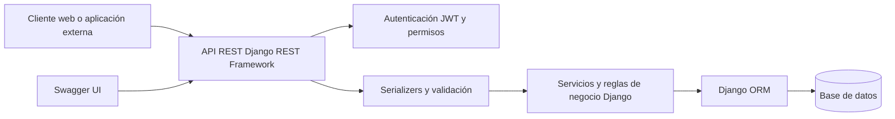

# Informe técnico: API RESTful municipal

## Introducción

El Sistema de Gestión de Resultados Municipal amplía los procesos de la aplicación web con una API RESTful autenticada y documentada. La API permite consultar y operar mantenedores y transacciones de negocio reutilizando los modelos, formularios, reglas territoriales y validaciones del proyecto Django.

## Arquitectura de la solución

- **Cliente:** consume recursos JSON mediante HTTP.
- **Documentación:** Swagger UI permite revisar contratos y probar solicitudes protegidas con JWT.
- **API:** Django REST Framework expone recursos bajo `/api/v1/`.
- **Negocio y persistencia:** la API delega validaciones y operaciones en las reglas existentes de Django y persiste mediante el ORM.

## Implementación de Django REST Framework

DRF, SimpleJWT y drf-spectacular están configurados en `requirements.txt` y `config/settings.py`. Los recursos están enrutados con un `DefaultRouter`; las operaciones de autenticación y las acciones de negocio usan rutas explícitas.

Los mantenedores de tipos de atención y subatenciones implementan consulta, creación, reemplazo y eliminación (`GET`, `POST`, `PUT`, `DELETE`). La eliminación se rechaza si existen registros relacionados. La transacción de actividades permite consultar, crear, modificar y eliminar cuando las reglas de integridad lo permiten. El resto de los recursos de negocio aplica las operaciones admitidas por sus respectivos estados y permisos.

Los serializers limitan los campos de salida y validan datos de entrada. Las escrituras de actividades y catálogos reutilizan formularios Django; las demás escrituras validan relaciones, delegaciones, responsables y transiciones de estado antes de guardar. Las operaciones que deben ser atómicas usan transacciones de base de datos.

## Autenticación y seguridad

- `POST /api/v1/auth/token/` obtiene access y refresh tokens.
- `POST /api/v1/auth/token/refresh/` renueva el access token; el refresh rota y el anterior queda invalidado.
- Los recursos requieren autenticación JWT o sesión. Swagger documenta el esquema Bearer para autorizar llamadas.
- Los access tokens expiran a los 15 minutos y los refresh tokens a las 24 horas.
- Las solicitudes de acceso y recuperación tienen límites de frecuencia; los intentos fallidos de inicio de sesión usan el bloqueo existente.
- Los permisos se determinan por rol y las consultas se acotan en el servidor a las delegaciones autorizadas.
- Las respuestas de listados omiten contenido sensible. La búsqueda de vecinos limita la información y enmascara el RUT; campos privados de vecinos se reservan al administrador. El perfil de usuario no entrega el correo privado a roles no administradores.
- Las entradas se validan antes de guardar. Los errores de validación entregan detalles accionables sin filtrar excepciones internas; los errores generales de la API no revelan detalles del servidor.
- La bitácora registra acciones operativas sin copiar contenidos sensibles de gestiones, cartas ni datos personales.
- La API emite JSON; la descarga autorizada de archivos de evidencia conserva su respuesta binaria para entregar el archivo solicitado.

### Recomendaciones de seguridad aplicadas

1. Aplicar mínimo privilegio por rol y validar la delegación en el servidor, sin confiar en identificadores enviados por el cliente.
2. Separar datos públicos y sensibles, devolver solo los campos necesarios y restringir la información privada a los roles autorizados.
3. Validar entradas y relaciones antes de modificar datos; envolver cambios relacionados en transacciones.
4. Usar JWT de vida acotada, rotación y revocación de refresh tokens, además de límites de solicitudes en autenticación.
5. Devolver errores seguros y registrar eventos de auditoría sin incluir datos sensibles.
6. Mantener CORS restringido a orígenes configurados explícitamente.

## Swagger/OpenAPI

- Swagger UI: `/api/documentacion/`.
- Esquema OpenAPI: `/api/esquema/`.
- Autenticación: esquema Bearer JWT con la opción **Authorize** de Swagger.
- La documentación describe las rutas, operaciones, datos de entrada y respuestas configuradas en la API.

## Conclusiones

La API reutiliza las reglas funcionales del sistema y separa autenticación, permisos, validación, serialización y persistencia. El control de acceso por rol y delegación, la minimización de datos y la documentación interactiva permiten consumir los servicios con un contrato explícito y respuestas JSON consistentes.
